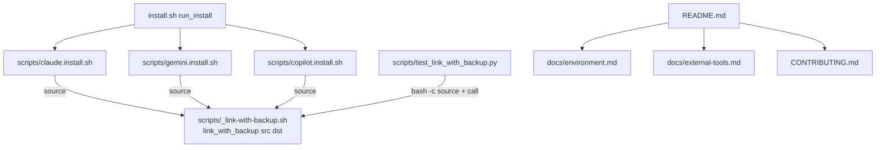

# README Improvement + Safe Global Config Linking Design

**Spec**: `.specs/features/readme-improvement/spec.md`
**Status**: Draft

---

## Architecture Overview

One sourced shell helper replaces four copy-pasted `if … rm …; fi; ln -s` blocks. Docs are
rewritten on top of the fixed behavior, so the README warning describes real code. A throwaway
check script (inline in the task, not committed) validates doc links, flags and aliases.

Approach was chosen during grilling (shared helper vs per-installer inline `mv` vs Python
helper); shared sourced helper won because installers already source `scripts/_git-exclude.sh`
the same way, and one implementation means one test file.

---

## Code Reuse Analysis

### Existing Components to Leverage

| Component                             | Location                                                                                                                            | How to Use                                                                                                                        |
| ------------------------------------- | ----------------------------------------------------------------------------------------------------------------------------------- | --------------------------------------------------------------------------------------------------------------------------------- |
| Sourced-helper pattern                | `scripts/_git-exclude.sh` (sourced at `scripts/claude.install.sh:4`, `scripts/gemini.install.sh:3`, `scripts/copilot.install.sh:3`) | Same header style ("Source this file; do not execute it"), same `source "$(dirname "${BASH_SOURCE[0]}")/…"` line                  |
| Subprocess + temp `HOME` test pattern | `scripts/test_aipp_settings.py:20-30` (`_run_cli`)                                                                                  | Same shape: `subprocess.run([...], env={**os.environ, "HOME": ...}, capture_output=True, text=True, check=False)` with `tmp_path` |
| Existing README tables                | `git show HEAD:README.md` sections "Environment Variables" (line 38) and "External Tools" (line 54)                                 | Moved verbatim to `docs/`                                                                                                         |
| Alias definitions                     | `.aipp.alias.zshrc`                                                                                                                 | Source of truth for alias names listed in README                                                                                  |
| Flag parsing                          | `install.sh` `case` block                                                                                                           | Source of truth for flags listed in README                                                                                        |

### Integration Points

| System                    | Integration Method                                                                                                                                                  |
| ------------------------- | ------------------------------------------------------------------------------------------------------------------------------------------------------------------- |
| `install.sh` → installers | Unchanged: `run_install` executes `$SOURCE/scripts/<name>.install.sh` with `SOURCE`/`LOCAL` in env                                                                  |
| pytest                    | New file under `scripts/` is auto-collected by `uv run --with pytest pytest scripts/`                                                                               |
| lefthook pre-commit       | `format_staged.py`, `lint_changed.py`, `test_changed.py`, `comment_policy_check.py` run on staged files - new comments must carry `why:` / `hazard:` / `invariant:` |

---

## Components

### link_with_backup (shell function)

- **Purpose**: Point `<dst>` at `<src>` via symlink without losing a regular file already at `<dst>`.
- **Location**: `scripts/_link-with-backup.sh` (sourced, not executed)
- **Interfaces**:
  - `link_with_backup <src> <dst>` - returns 0 on success; 1 when `<dst>` is a directory.
- **Behavior** (order matters):
  1. `[ -d "$dst" ] && [ ! -L "$dst" ]` → stderr warning, `return 1`.
  2. `mkdir -p "$(dirname "$dst")"`.
  3. `[ -L "$dst" ]` → `rm -f "$dst"` (no backup).
  4. `elif [ -f "$dst" ]` → `mv -f "$dst" "$dst.bak"`; echo `backup: $dst -> $dst.bak`.
  5. `ln -s "$src" "$dst"`.
- **Dependencies**: coreutils only.
- **Reuses**: header/sourcing convention of `scripts/_git-exclude.sh`.

Check `-L` before `-f`/`-d`: `-f` and `-d` follow symlinks, so a symlink to a file or a
directory must be classified as a symlink first. Step 1 therefore excludes symlinks.

### Installer call sites

- **Purpose**: Replace delete-then-link with `link_with_backup`.
- **Location**:
  - `scripts/claude.install.sh:123-126` → `link_with_backup "$SOURCE/claude/settings.json" "$HOME/$DEFAULT_FOLDER/settings.json"` (the preceding `mkdir -p` at line 122 can stay).
  - `scripts/gemini.install.sh:95-98` → `link_with_backup "$SOURCE/gemini/settings.json" "$HOME/$DEFAULT_FOLDER/settings.json"`.
  - `scripts/copilot.install.sh:6-9` and `:11-14` → two calls for `mcp-config.json` and `config.json`.
- Each file adds `source "$(dirname "${BASH_SOURCE[0]}")/_link-with-backup.sh"` next to its existing `_git-exclude.sh` source line (line 3 or 4).

### Test file

- **Purpose**: Assert spec AC LINK-01..07 against the real helper.
- **Location**: `scripts/test_link_with_backup.py`
- **Interfaces**: helper `_link(src, dst)` → `subprocess.run(["bash", "-c", 'source "$0"; link_with_backup "$1" "$2"', HELPER, src, dst], ...)` (paths passed as positional args, never interpolated).
- **Cases**: missing dst; symlink dst; dangling symlink dst; regular file (content of `.bak` == original, dst `readlink` == src); regular file with old `.bak` (overwritten); directory (unchanged, rc 1, stderr non-empty); missing parent dir; stdout `backup:` line; path with spaces; second call after backup leaves `.bak` unchanged.

### Docs

- `docs/environment.md`, `docs/external-tools.md` - title + verbatim table.
- `README.md` - section order from spec README-01.
- `CONTRIBUTING.md` - sections from spec CONTRIB-01..04.
- `AGENTS.md` - one-line change in the "Run tests" fenced block.

### Doc check (inline, not committed)

Run during doc tasks; ponytail: one-off Python snippet, promote to a script only if docs churn:

- links: regex `\]\(([^)#]+)` on each doc, skip `http`, assert `Path(doc).parent / target` exists.
- flags: each `--flag` in README flags table appears as a `case` label in `install.sh`.
- aliases: each alias in README aliases section matches `^alias <name>=` or a function name in `.aipp.alias.zshrc`.

---

## Error Handling Strategy

| Error Scenario              | Handling                                                      | User Impact                                                     |
| --------------------------- | ------------------------------------------------------------- | --------------------------------------------------------------- |
| `<dst>` is a real directory | Warn on stderr, return 1, touch nothing                       | Installer prints warning, continues (no `set -e` in installers) |
| Parent dir missing          | `mkdir -p`                                                    | Copilot install now works on a fresh machine                    |
| `ln -s` fails after `mv`    | Original stays at `<dst>.bak`; `backup:` line already printed | User restores from `.bak` per README                            |
| Regular file + old `.bak`   | `mv -f` overwrites `.bak`                                     | Only the most recent real file is kept (grilled policy)         |

---

## Risks & Concerns

| Concern                                                                      | Location (file:line)                                              | Impact                                                            | Mitigation                                                             |
| ---------------------------------------------------------------------------- | ----------------------------------------------------------------- | ----------------------------------------------------------------- | ---------------------------------------------------------------------- |
| `rm -rf` on an unquoted path                                                 | `scripts/claude.install.sh:124`                                   | Word-splitting on `$HOME` with spaces could delete the wrong path | Removed by the helper swap; helper quotes every expansion              |
| Unquoted `rm` paths                                                          | `scripts/gemini.install.sh:96`, `scripts/copilot.install.sh:7,12` | Same class                                                        | Removed by the helper swap                                             |
| `~/.copilot` not created                                                     | `scripts/copilot.install.sh:6-14`                                 | `ln` fails on a fresh machine                                     | Helper `mkdir -p` parent (LINK-06)                                     |
| Installers hardcode `$HOME/.claude` while bootstrap sets `CLAUDE_CONFIG_DIR` | `scripts/claude.install.sh:2,122`                                 | Settings may land outside the active config dir                   | Out of scope; not changed by this feature                              |
| Installer scripts have no tests                                              | `scripts/*.install.sh`                                            | Wiring regressions undetected                                     | T3-T5 verify by fake-`HOME` run + `bash -n`; helper itself unit-tested |
| `AGENTS.md` has uncommitted owner hunks                                      | `AGENTS.md:55-58,100-104`                                         | Accidental revert or inclusion in commit                          | T6 edits only the test block; stage with `git add -p` only that hunk   |

---

## Tech Decisions (only non-obvious ones)

| Decision                                         | Choice                  | Rationale                                                             |
| ------------------------------------------------ | ----------------------- | --------------------------------------------------------------------- |
| Symlink check first                              | `-L` before `-d` / `-f` | `-d`/`-f` follow links; a link to a dir must be replaced, not refused |
| `mv -f` not `cp`                                 | move                    | Keeps one copy, atomic on same filesystem                             |
| Pass paths as `bash -c` positional args in tests | `"$1" "$2"`             | Avoids shell injection and quoting bugs with spaces                   |
| Doc check not committed                          | inline snippet          | YAGNI; no CI runs doc checks today                                    |
