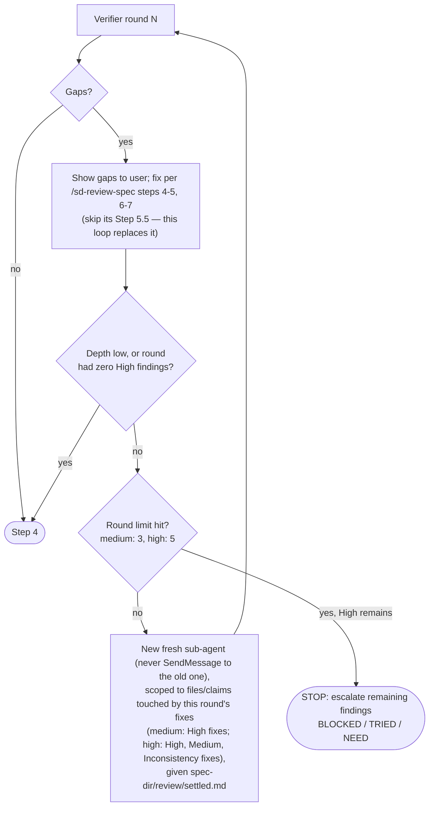

# Step 3 — Verifier pass and depth-driven fix loop

Always-on, author ≠ verifier. Never skip it and never ask whether to run it; only ask what to do with findings.

## 3a. Settle the review depth

| Condition                                             | Action                                                                                                                                                                                                                                                                                                  |
| ----------------------------------------------------- | ------------------------------------------------------------------------------------------------------------------------------------------------------------------------------------------------------------------------------------------------------------------------------------------------------- |
| `/sd-planning` invoked with `depth=low\|medium\|high` | Use it                                                                                                                                                                                                                                                                                                  |
| No `depth` argument                                   | Ask once with `AskUserQuestion` before dispatching, explaining each level as in `/sd-review-spec`'s Review depth table: `low` = no re-verification after fixes (cheapest); `medium` = re-verify High fixes only (recommended); `high` = re-verify High, Medium and Inconsistency fixes (most expensive) |

## 3b. Dispatch the verifier

| Rule         | Detail                                                                                                                                                                            |
| ------------ | --------------------------------------------------------------------------------------------------------------------------------------------------------------------------------- |
| Agent        | Fresh sub-agent, `model: "sonnet"`; effort `high` in round 1, `medium` in later rounds; no inherited context from steps 1-2                                                       |
| Runs         | `/sd-review-spec` in report-only mode against `spec.md`, `design.md`, `tasks.md`, `requirements.md`, cited ADRs                                                                   |
| Input (only) | Original feature request, verbatim as the user stated it; the feature's spec dir path                                                                                             |
| Checks       | Every doc claim vs real code; full set covers what the original request needs: scope, constraints, edge cases, dependencies, every `requirements.md` requirement traced to a task |
| Output       | No edits; returns the severity-classified gap report (same table as `/sd-review-spec` step 8)                                                                                     |

## 3c. Fix loop

| Rule                      | Detail                                                                                        |
| ------------------------- | --------------------------------------------------------------------------------------------- |
| Re-verified severities    | Fixes the next round checks. `low`: none; `medium`: High; `high`: High, Medium, Inconsistency |
| Outside re-verified       | One fix pass, no re-verification (`low`: every finding, step ends after one fix pass)         |
| Loop ends                 | Round reports zero High findings, or round limit (3 at `medium`, 5 at `high`)                 |
| Limit hit with High left  | STOP, escalate to the user (BLOCKED / TRIED / NEED); never apply another round of fixes       |
| Round with zero High      | Its Medium and Inconsistency findings get one fix pass; no new round, even at `high`          |
| Scope of re-verify rounds | Only files/claims touched by the fixes, not the full doc set                                  |
| Settled list              | Pass `<spec-dir>/review/settled.md` so contested/declined findings are not reopened           |
